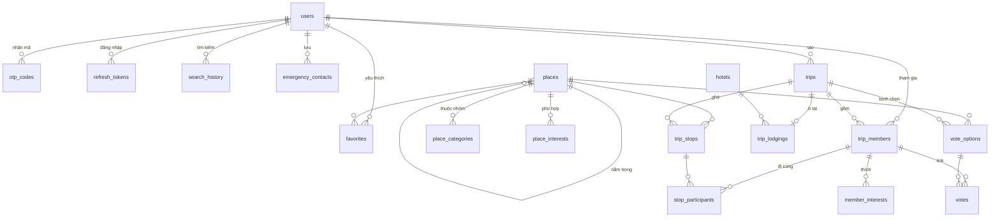

# Thiết kế database

MySQL 8.4, truy cập qua Prisma ([backend/prisma/schema.prisma](../backend/prisma/schema.prisma)). Bảng được tạo dần theo từng module của backend; mục "Tạo ở" cho biết bước nào thêm bảng đó. Bảng chưa tạo có thể được chỉnh lại khi làm module tương ứng.

## Quy ước

- Tên bảng và cột dùng `snake_case`; model và field trong Prisma dùng `PascalCase`/`camelCase` (ánh xạ bằng `@@map`, `@map`).
- Khóa chính là số nguyên tự tăng. Quyền truy cập luôn được kiểm tra ở API, không dựa vào việc id khó đoán.
- Tiền là số nguyên VND, tính cho một người. Giá từ nguồn dùng ngoại tệ được đổi sang VND lúc lấy giá.
- Thời gian lưu theo UTC. Số điện thoại lưu theo E.164 (vd. `+84905128846`).
- Không lưu số liệu tính lại được (tổng dồn, số tiền còn lại, quãng đường): API tính khi trả kết quả.

## Sơ đồ

## Tài khoản

### `users` · tạo ở A4

| Cột | Kiểu | Ghi chú |
| --- | --- | --- |
| id | INT | Khóa chính |
| email | VARCHAR(254), unique | Có thể trống nếu đăng ký bằng số điện thoại |
| phone | VARCHAR(16), unique | E.164; có thể trống nếu đăng ký bằng email |
| password_hash | VARCHAR(255) | Mật khẩu đã hash, không lưu mật khẩu gốc |
| full_name | VARCHAR(100) | |
| avatar_url | VARCHAR(2048) | Ảnh trên S3 (giai đoạn B) |
| verified_at | DATETIME | Trống khi chưa nhập đúng mã OTP đăng ký; chưa xác thực thì chưa đăng nhập được |
| password_changed_at | DATETIME | Lần đổi mật khẩu gần nhất; token đặt lại mật khẩu cấp trước thời điểm này hết hiệu lực (mỗi token chỉ dùng một lần). Thêm ở A6 |
| created_at, updated_at | DATETIME | |

Ràng buộc `CHECK`: phải có ít nhất một trong `email`, `phone`.

### `otp_codes` · A6

| Cột | Kiểu | Ghi chú |
| --- | --- | --- |
| id | INT | |
| user_id | INT → users | Xóa user thì xóa luôn mã |
| purpose | ENUM(REGISTER, RESET_PASSWORD) | |
| destination | VARCHAR(254) | Email hoặc số điện thoại (E.164) đã gửi mã |
| code_hash | CHAR(64) | HMAC-SHA256 của mã 6 số với khóa bí mật của server, để database bị lộ cũng không dò ra mã |
| expires_at | DATETIME | 15 phút sau khi gửi |
| attempts | INT | Số lần đã thử; tới 5 lần thì khóa mã, phải xin mã mới |
| used_at | DATETIME | Trống khi chưa dùng |
| created_at | DATETIME | Gửi lại được sau 60 giây kể từ mã gần nhất |

Chỉ mã mới nhất của một user và một mục đích có hiệu lực. Chỉ mục (user_id, purpose, created_at).

### `refresh_tokens` · A6

| Cột | Kiểu | Ghi chú |
| --- | --- | --- |
| id | INT | |
| user_id | INT → users | Xóa user thì xóa luôn token |
| token_hash | CHAR(64), unique | SHA-256 của token ngẫu nhiên 32 byte; token gốc chỉ gửi cho app |
| expires_at | DATETIME | 30 ngày sau khi cấp |
| revoked_at | DATETIME | Đổi token, đăng xuất hoặc đặt lại mật khẩu thì thu hồi |
| created_at | DATETIME | |

Mỗi lần làm mới, token cũ bị thu hồi và cấp token mới. Nếu một token đã thu hồi bị dùng lại (dấu hiệu bị lộ), mọi token của user đó bị thu hồi.

## Địa điểm

### `places` · tạo ở A7

Hai loại dòng:

- **CATALOG**: danh mục riêng của TripFair (hiện là dữ liệu mẫu Đà Nẵng nạp bằng `npm run db:seed`), lưu đủ mọi cột.
- **GOOGLE**: điểm tìm thấy qua Google Places. Điều khoản Google chỉ cho lưu lâu dài `place_id`, nên dòng này chỉ có `google_place_id`; tên, tọa độ, rating, giờ mở cửa được lấy trực tiếp từ Google mỗi lần hiển thị. Dòng này cho điểm Google một id của TripFair để dùng trong chi tiết, yêu thích và lộ trình.

| Cột | Kiểu | Ghi chú |
| --- | --- | --- |
| id | INT | |
| source | ENUM(CATALOG, GOOGLE) | |
| slug | VARCHAR(100), unique | Khóa ổn định của điểm trong danh mục, vd. `golden-bridge`; seed cập nhật theo cột này |
| google_place_id | VARCHAR(255), unique | Bắt buộc với dòng GOOGLE |
| name, area, city | VARCHAR | `area` là dòng dưới tên, vd. "Bà Nà Hills · Hòa Vang" |
| category | ENUM(FOOD, FUN, SCENIC) | Nhóm chính, dùng làm nhãn: Ăn uống, Vui chơi, Cảnh đẹp |
| lat, lng | DOUBLE | Tọa độ, dùng tính khoảng cách |
| rating, rating_count | DOUBLE, INT | |
| open_minute, close_minute | INT | Giờ mở/đóng cửa tính bằng phút từ 0:00; cả hai trống là mở cả ngày; đóng nhỏ hơn mở là đóng sau nửa đêm |
| description, image_url | TEXT, VARCHAR | |
| visit_minutes | INT | Thời gian ghé thăm dự kiến |
| price_min, price_max | INT | VND/người; bằng nhau khi là giá cố định; 0 là miễn phí; trống khi vé của khu bao ngoài đã gồm điểm này |
| price_source | ENUM(PARTNER_API, GOOGLE_API, ESTIMATED) | Giá khác PARTNER_API hiển thị kèm dấu ~ |
| price_provider | VARCHAR(100) | Klook, GetYourGuide, Tiqets, Google, TripFair (ước tính) |
| price_updated_at | DATETIME | |
| parent_id | INT → places | Khu có bán vé chứa điểm này, vd. Cầu Vàng nằm trong Bà Nà Hills |
| search_text | VARCHAR(600) | Tên, khu vực, thành phố viết thường, bỏ dấu (đ → d), để tìm kiếm không dấu |
| created_at, updated_at | DATETIME | |

Ràng buộc `CHECK`: dòng GOOGLE phải có `google_place_id`; dòng CATALOG phải có slug, tên, thành phố, nhóm, tọa độ, thời gian ghé và `search_text`; khoảng giá hợp lệ (`0 ≤ min ≤ max`); giờ mở cửa trong khoảng 0–1439. MySQL không cho CHECK dùng cột có khóa ngoại kèm hành động (`parent_id`), nên quy tắc "có giá hoặc có khu cha có giá" do script seed kiểm tra.

**Giá** (theo thứ tự):

1. Điểm trong danh mục: giá riêng của điểm; nếu không có thì lấy giá vé của khu bao ngoài và ghi rõ "đã gồm trong vé …". Khi lập lộ trình (A8), điểm như vậy tính 0đ nếu vé khu đã có trong lộ trình.
2. Điểm từ Google (không có vé đối tác): `priceRange` của Google → loại điểm thường miễn phí (bãi biển, công viên, chùa, nhà thờ, cầu…) = 0đ ước tính → bảng quy đổi `priceLevel` (mức 1: 20–50k, mức 2: 50–150k, mức 3: 150–500k, mức 4: 500k–1,5 triệu) → mức mặc định theo nhóm. Điểm nào cũng có giá.

Thuật toán dùng `price_max` làm chi phí của điểm để không ai vượt ngân sách khi giá thật cao; giao diện hiện cả khoảng giá.

### `place_categories` · tạo ở A7

Khóa chính (place_id, category). Mọi nhóm của một điểm (gồm cả nhóm chính) để lọc, vd. Chợ đêm Sơn Trà thuộc cả Vui chơi và Ăn uống. Điểm GOOGLE không có dòng ở đây; nhóm của chúng được suy ra từ loại địa điểm Google trả về.

### `place_interests` · A8

Khóa chính (place_id, interest). `interest` là một trong 8 sở thích của app: FOOD (ẩm thực), BEACH (biển), SCENERY (cảnh đẹp), RELAX (thư giãn), FUN (vui chơi), PHOTO (chụp ảnh), CULTURE (văn hóa), EXPLORE (khám phá). Thuật toán so sở thích của thành viên với sở thích của điểm để tính mức hài lòng.

### `search_history` · tạo ở A7

| Cột | Kiểu | Ghi chú |
| --- | --- | --- |
| id | INT | |
| user_id | INT → users | Xóa user thì xóa luôn lịch sử |
| query | VARCHAR(100) | Từ khóa theo cách gõ gần nhất |
| normalized_query | VARCHAR(100) | Viết thường, bỏ dấu; unique theo (user_id, normalized_query) nên "Đà Nẵng" và "da nang" là một mục |
| category | ENUM, trống được | Bộ lọc dùng kèm từ khóa |
| searched_at | DATETIME | Tìm lại cùng từ khóa thì cập nhật thời điểm, mục đó lên đầu |

Lịch sử được lưu khi gọi `GET /places?q=…` có từ khóa (gợi ý khi đang gõ thì không lưu); mỗi người giữ 50 mục gần nhất.

## Chuyến đi

Thiết kế các bảng dưới đây được xem lại ở A8, khi chốt các câu hỏi mở [Trip] (khung giờ mỗi ngày, cách tính khoảng cách).

### `trips` · A8

| Cột | Kiểu | Ghi chú |
| --- | --- | --- |
| id | INT | |
| owner_id | INT → users | Người tạo chuyến |
| type | ENUM(SOLO, GROUP) | Chuyến một mình có đúng một thành viên |
| name | VARCHAR | Tên nhóm, vd. "Nhóm Đà Nẵng" |
| destination | VARCHAR | |
| start_date, end_date | DATE | |
| lodging_mode | ENUM(HOTEL, SELF) | SELF là "Tự lo chỗ ở"; ngân sách 0đ mặc định SELF |
| status | ENUM(DRAFT, PLANNED) | DRAFT khi đang mời thành viên, bình chọn |
| invite_code | VARCHAR, unique | Mã tham gia nhóm, vd. DN1214; trống với chuyến một mình |
| vote_deadline | DATETIME | Hạn bình chọn của nhóm |
| created_at, updated_at | DATETIME | |

Mỗi nhóm lập đúng một chuyến nên thông tin nhóm nằm luôn trong `trips`.

### `trip_members` · A8

| Cột | Kiểu | Ghi chú |
| --- | --- | --- |
| id | INT | |
| trip_id, user_id | INT | Unique theo cặp |
| role | ENUM(OWNER, MEMBER) | |
| budget | INT | Ngân sách tối đa; API chỉ trả cho chính người đó, cả nhóm chỉ thấy phần chi |
| lodging_share | INT | Phần tiền phòng của người này (chia đều cho người ở chung phòng) |
| satisfaction | TINYINT | Mức hài lòng (%) sau khi tối ưu |
| ballot_sent_at | DATETIME | Thời điểm gửi phiếu bình chọn |
| joined_at | DATETIME | |

### `member_interests` · A8

Khóa chính (member_id, interest), cùng danh sách sở thích với `place_interests`. Lưu theo từng chuyến vì mỗi chuyến có thể chọn sở thích khác.

### `hotels` · A8

id, agoda_hotel_id (unique), name, address, lat, lng, rating, image_url, updated_at. Chỉ lưu thông tin cố định của khách sạn; giá phòng thay đổi theo ngày nên 3 gợi ý (rẻ nhất, cân bằng, gần lộ trình nhất) được tính lúc gọi API, không lưu.

### `trip_lodgings` · A8

| Cột | Kiểu | Ghi chú |
| --- | --- | --- |
| trip_id | INT → trips | Khóa chính; mỗi chuyến tối đa một nơi ở |
| hotel_id | INT → hotels | |
| check_in, check_out | DATE | |
| rooms, guests_per_room | INT | |
| price_per_night | INT | Giá một phòng một đêm, chụp lại lúc chọn |
| price_provider, price_fetched_at | VARCHAR, DATETIME | |

### `trip_stops` · A8

| Cột | Kiểu | Ghi chú |
| --- | --- | --- |
| id | INT | |
| trip_id | INT → trips | |
| place_id | INT → places | |
| day, position | INT | Ngày thứ mấy và thứ tự trong ngày |
| start_minute | INT | Giờ bắt đầu, tính bằng phút từ 0:00 |
| visit_minutes | INT | |
| cost_per_person | INT | Giá chụp lại lúc lập lộ trình |
| price_source | ENUM | Chụp lại cùng với giá |

Giá được chụp lại vì giá đối tác thay đổi, còn lộ trình đã lập phải giữ đúng số đã tính. Điểm lưu trú trên dòng thời gian được API ghép từ `trip_lodgings`.

## Nhóm

### `vote_options` · A9

id, trip_id → trips, place_id → places (unique theo cặp), added_by → trip_members, created_at. Các địa điểm thành viên đưa vào bình chọn.

### `votes` · A9

Khóa chính (option_id, member_id). Mỗi dòng là một thành viên tick đồng ý một địa điểm; số phiếu là đầu vào cho mức giá trị của điểm.

### `stop_participants` · A9

Khóa chính (stop_id, member_id). Ai đi điểm nào; phần chi của một người là tổng `cost_per_person` các điểm người đó đi cộng `lodging_share`. Vd. một thành viên không đi Cầu Vàng thì không trả vé 900.000đ.

## Cá nhân

### `favorites` · tạo ở A7

Khóa chính (user_id, place_id), created_at; chỉ mục place_id. Lưu lại một điểm đã lưu hoặc bỏ lưu điểm chưa lưu đều không lỗi. Xóa user hoặc điểm thì xóa luôn dòng yêu thích. Điểm GOOGLE trong danh sách yêu thích được lấy chi tiết trực tiếp từ Google khi hiển thị.

### `emergency_contacts` · A10

id, user_id → users, name, relation, phone (E.164), receives_sos (nhận tin SOS hay không), created_at. Lưu trên server để giữ được khi đổi điện thoại; app Android giữ bản sao để SOS vẫn chạy khi mất mạng.

## Không lưu trong database

- **Đánh giá địa điểm**: lấy từ Google Places API (New), không có bảng `reviews`.
- **Kết quả nhận diện ảnh**: Cloud Vision trả kết quả theo từng lần chụp, không cần lưu.
- **Gợi ý khách sạn**: tính lúc gọi API theo ngày của chuyến đi.
